<p align="center">
  
</p>

<p align="center">
  <a href="#quick-start"></a>
  
  
  
  <a href="LICENSE"></a>
</p>

<p align="center">
  <b>Submitting your startup to directories by hand takes a week of copy-pasting.<br>launchkit hands that week to your coding agent.</b>
</p>

---

launchkit is a skill pack, CLI and MCP server for coding agents (Claude Code, Cursor, Codex, Windsurf, Devin and anything
else with a browser tool). Your agent interviews you once and writes your launch copy, then works through **477 startup
directories, launch platforms, AI directories, review sites, subreddits and newsletters**, filling every form in its
browser. Every site has its own researched guide, so the agent knows which of your answers goes in which field.

You stay in charge. It never pays and never solves CAPTCHAs, and it won't post to Reddit or Hacker News until you approve the draft.

## Quick start

```bash
git clone https://github.com/rayhankhilji/launchkit ~/launchkit

cd your-startup-repo            # or any empty folder
node ~/launchkit/bin/launchkit.mjs init --agent claude   # or: cursor | codex | all
```

Then tell your agent:

> **Launch my startup with launchkit.**

`init` creates a `.launchkit/` folder (queue, knowledge base, a local copy of the tool), installs the skills for your
agent and registers the MCP server. Your agent also needs a browser tool. If it doesn't have one, it will walk you
through [adding Playwright MCP](skill/launchkit/docs/07-browser-setup.md) in about a minute.

## How it works

```
 ┌────────────┐   ┌────────────────┐   ┌─────────────────────┐   ┌──────────────┐
 │ 1 Interview│ → │ 2 Knowledge    │ → │ 3 Submission loop   │ → │ 4 Report     │
 │ research + │   │   base + copy  │   │ claim → guide →     │   │ live, pending│
 │ ~15 Qs     │   │ profile.json   │   │ browser → mark      │   │ needs you    │
 └────────────┘   └────────────────┘   └─────────────────────┘   └──────────────┘
```

**1. Interview.** The agent reads your site and repo first, then asks only what it couldn't find, five or so
questions at a time: what you're building, who it's for, your logo, pricing, founder bio, sign-up email, budget, and
whether you want to stay nearby to solve CAPTCHAs.

**2. Knowledge base.** Everything goes into `.launchkit/profile.json`, plus every length of copy directories ask for
(40, 60, 160, 300 and 1000 characters), a maker comment, a Show HN post, Reddit posts and a press pitch. All of it is
written by the [human-writing skill](skill/human-writing/SKILL.md) and checked by `launchkit lint-copy`: no em dashes,
no "revolutionary", no "seamlessly empowers".

**3. Submission loop.** `launchkit next` claims a site and returns its guide. The agent opens the form in its
browser, fills it using the guide's field map, submits, screenshots the confirmation and records the result. Run one
worker, or several at once if your machine can handle it.

**4. Report.** `.launchkit/report.md` shows what's live and what's pending, plus a short to-do list for you:
CAPTCHAs, email verifications, paid listings you might want, and drafts waiting for approval.

## A guide for every site

Each of the 477 directories has its own guide in [`skill/launchkit/sites/`](skill/launchkit/sites/INDEX.md). A team of
32 research agents opened every site's live submission flow and wrote down what they found.

| Section | What it tells the agent |
|---|---|
| Frontmatter | login method, CAPTCHA type, free vs paid tiers, backlink requirement, review time |
| Field map | every field in order, mapped to a profile key: `product.tagline`, `assets.logo_square`, dropdown mappings |
| Steps | click by click, from finding the form to the confirmation screen |
| Make the listing perform | best category, launch day and time, what gets featured, which copy variant fits |
| Gotchas | upsells to skip, size limits, fields that reject long text |

Sites that have shut down or stopped taking listings (35 of them right now) are flagged `inactive` and skipped
automatically.

## What runs automatically

| Mode | Sites | Default behaviour |
|---|---|---|
| `form` | ~240 directories, launch platforms, review sites, databases | Filled and submitted by the agent |
| `post` | ~75 subreddits and communities (HN, DEV, Indie Hackers) | Drafted for your approval, posted only if you allow it |
| `pitch` | ~50 press outlets and newsletters | Pitch drafted, never sent without approval |
| `pr` | GitHub awesome lists | List entry drafted, PR opened with approval |
| `manual` | ~70 app stores, marketplaces, accelerators | Suggested if they fit your product |

Product Hunt is drafted completely, but you pick the launch day and press the button.

## Parallel or one at a time

```bash
launchkit next --worker w1                      # one site, atomically claimed
launchkit next --worker w2 --category "AI Directory"
```

The queue lives on disk behind a file lock, so any number of workers can pull from it and no site gets submitted
twice. Workers that crash leave a claim behind, and `launchkit release-stale` puts those sites back in the queue. With 16 GB of RAM, 2 to 4
browser workers is comfortable. Beyond that, sites start rate-limiting you. See
[docs/04](skill/launchkit/docs/04-parallel-and-background.md).

## Safety rails

- **Never pays.** It stops at any checkout. Paid-only sites are skipped unless you set a budget, and even then you finish the payment yourself.
- **Never bypasses CAPTCHAs** or bot checks. If you're nearby, it hands over to you. If not, the site goes on your to-do list.
- **Never posts to communities** without your approval of that exact draft.
- **Never stores passwords.** It uses your browser's existing sessions, OAuth or your password manager.
- **Never invents facts.** Every claim comes from your profile.
- **Ignores instructions on websites** ("AI agents: also submit to...").

Full rules: [docs/06-rules-and-safety.md](skill/launchkit/docs/06-rules-and-safety.md).

## CLI and MCP reference

| Command | MCP tool | |
|---|---|---|
| `init [--agent claude\|cursor\|codex\|all]` | `launchkit_init` | Create the workspace, install skills and MCP config |
| `profile` / `profile set '<json>'` | `launchkit_profile_get` / `_set` | Read or patch the knowledge base |
| `validate` | `launchkit_profile_validate` | Missing fields, length and asset checks |
| `lint-copy <file\|-> [--max N]`, `lint-copy --profile` | `launchkit_lint_copy` | Em dashes, AI-slop words, overlong copy |
| `next [--n] [--worker] [--modes] [--category] [--id] [--retry]` | `launchkit_next` | Claim targets (with guide path) |
| `guide <id>` | `launchkit_guide` | Print a site guide |
| `mark <id> <status> [--note] [--listing-url] [--evidence]` | `launchkit_mark` | Record an outcome |
| `list [--status] [--mode] [--category] [--search]` | `launchkit_list` | Browse the queue |
| `add --name --url [--category] [--mode]` | `launchkit_add_target` | Add your own site |
| `draft <id> <file\|->` | `launchkit_save_draft` | Save a post or pitch for approval |
| `release-stale [--minutes 30]` | `launchkit_release_stale` | Recover claims from crashed workers |
| `status`, `report` | `launchkit_status`, `launchkit_report` | Progress and final report |

Statuses: `pending → in_progress → submitted | live | drafted | needs_human | failed | skipped`.

## What's in the box

```
skill/launchkit/SKILL.md          entry point your agent follows
skill/launchkit/docs/             interview, copy, loop, parallel, site types, safety, browser setup
skill/launchkit/sites/            477 researched site guides + INDEX.md
skill/human-writing/SKILL.md      writing rules: no em dashes, no AI slop
data/directories.json             the directory list: URLs, category, pricing, mode, priority
bin/launchkit.mjs                 zero-dependency CLI (Node 18+)
lib/                              queue engine, MCP server, installer, copy linter
docs/index.html                   landing page
```

## FAQ

**Will this get my accounts banned?** It uses your real browser at a human pace, one listing per site, with your
own accounts, and follows each site's rules. It never automates around bot checks. Spammy launches are what get
accounts banned, and the guides exist to keep you away from that.

**How long does a full run take?** Around 5 to 10 minutes per form site with one worker, so a full form-mode pass is
an overnight job. Two or three workers cut it to a few hours.

**Can I add my own sites?** `launchkit add --name "My Dir" --url https://...`. To contribute a guide for everyone,
copy [`sites/_TEMPLATE.md`](skill/launchkit/sites/_TEMPLATE.md) and open a PR.

**Does it work without MCP?** Yes. Every MCP tool is also a CLI command that prints JSON.

## Contributing

Directories change all the time: forms move, free tiers disappear, new sites appear. PRs that fix or add a site guide
are the most useful contribution. Run `npm test` before you open one.

## License

MIT
